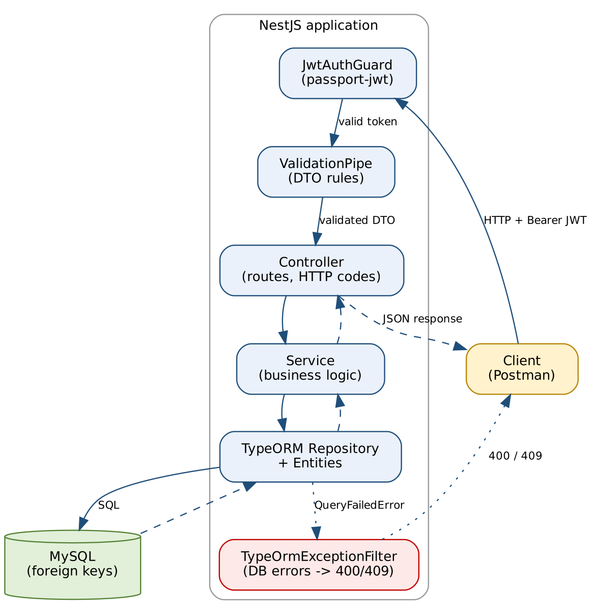
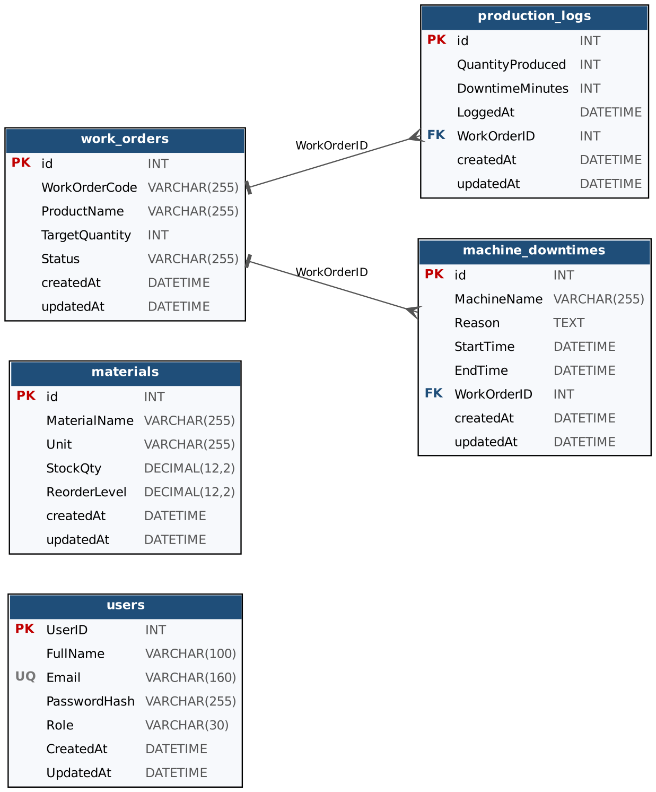

# Production Monitoring and Inventory Management System (PMIMS) — Technical Documentation


## 1. Project Overview

The Production Monitoring and Inventory Management System (PMIMS) is a backend prototype for the manufacturing domain. It is a RESTful web service that stores its data in a MySQL database through TypeORM, exposes 27 REST endpoints built with NestJS, and protects every business route with JWT authentication.


### 1.1 Objectives

- Design and implement a RESTful backend following resource-oriented URIs, correct HTTP methods and status codes.
- Model the domain as a normalised relational database and map it to TypeORM entities with correct relationships.
- Secure the API with JWT login, bcrypt password hashing, protected routes and input validation.
- Test and document every endpoint using Postman and an exported collection.
- Use Git and GitHub for incremental, version-controlled development.


### 1.2 Major Features

- User registration and login with hashed passwords and JWT access tokens.
- Full CRUD (create, list, count, read, update, delete) for 4 resources: Material, WorkOrder, MachineDowntime, ProductionLog.
- Foreign-key integrity enforced by MySQL (ON DELETE RESTRICT) and reported to clients as clear 400 / 409 responses.
- Global request validation that rejects invalid or unknown fields.
- Postman collection with automated assertions, auto-saved token and auto-saved record IDs.


### 1.3 Technology Stack

| Component | Technology |
|---|---|
| Backend framework | NestJS 10 (Node.js 20+) |
| ORM | TypeORM 0.3 |
| Database | MySQL 8 (mysql2 driver) |
| Authentication | JWT (@nestjs/jwt, passport-jwt), bcrypt |
| Validation | class-validator, class-transformer |
| API testing | Postman |
| Version control | Git & GitHub |


## 2. System Analysis

The system manages the core records of a manufacturing information system: Material, WorkOrder, MachineDowntime, ProductionLog. All records are created and maintained by authenticated users through the API.


### 2.1 Actors

| Actor | Description |
|---|---|
| Registered user | Registers, logs in, and manages all domain records through authenticated API calls. |
| API client | Postman (or any HTTP client / future frontend) that sends JSON requests with a Bearer token. |


### 2.2 Functional Requirements

| ID | Requirement |
|---|---|
| FR-01 | A visitor can register an account; the password is stored only as a bcrypt hash. |
| FR-02 | A registered user can log in and receive a signed JWT. |
| FR-03 | A logged-in user can retrieve their own profile (GET /auth/me). |
| FR-04 | A user can create, list, count, retrieve, update and delete Material records. |
| FR-05 | A user can create, list, count, retrieve, update and delete WorkOrder records. |
| FR-06 | A user can create, list, count, retrieve, update and delete MachineDowntime records. |
| FR-07 | A user can create, list, count, retrieve, update and delete ProductionLog records. |
| FR-08 | Requests without a valid token are rejected with 401 on every business route. |
| FR-09 | Invalid input is rejected with 400; unknown ids return 404; foreign-key conflicts return 400 / 409. |


### 2.3 Non-Functional Requirements

- Security: JWT authentication, bcrypt hashing, secrets only in environment variables.
- Data integrity: primary keys, foreign keys and NOT NULL constraints in MySQL.
- Maintainability: one module per resource (entity, DTO, service, controller, module).
- Testability: every endpoint is covered by a Postman request with assertions.


### 2.4 Scope and Assumptions

This is a backend-focused prototype; no frontend is included. Authorisation is limited to “authenticated user”; the role column and JWT role claim are in place for future role-based rules.


## 3. System Architecture

The application follows a layered architecture. Each request travels Client → Guard → Pipe → Controller → Service → Repository → MySQL, and the result travels back along the same path. A global exception filter converts database constraint errors into proper HTTP responses.



*Figure 1 — Request flow through the application layers*


### 3.1 Layer Responsibilities

| Layer | Responsibility |
|---|---|
| JwtAuthGuard | Verifies the Bearer token; rejects missing/invalid/expired tokens with 401. |
| ValidationPipe | Validates and whitelists the request body against the DTO; returns 400 on violations. |
| Controller | Declares routes and HTTP methods, extracts params/body, returns the service result. |
| Service | Business logic: maps foreign-key ids to relations, throws 404 when a record is missing. |
| Repository / Entity | TypeORM maps entities to tables and runs parameterised SQL. |
| TypeOrmExceptionFilter | Maps MySQL errors (1062, 1451, 1452, …) to 409 / 400 instead of 500. |
| MySQL | Stores the data and enforces keys and constraints. |


### 3.2 Project Structure

```
src/
  main.ts                 bootstrap, global prefix /api, pipes, filter
  app.module.ts           ConfigModule, TypeORM connection, feature modules
  auth/                   register, login, me, JwtStrategy, JwtAuthGuard, jwt.config.ts
  users/                  User entity
  common/                 TypeOrmExceptionFilter
  modules/<resource>/     entity, dto, service, controller, module
```


### 3.3 Configuration

Configuration is read through ConfigService from a .env file (never committed): DB_HOST, DB_PORT, DB_USER, DB_PASSWORD, DB_NAME, JWT_SECRET, JWT_EXPIRES_IN, PORT. The JWT secret is read in one function (jwt.config.ts) that is used by both the token signer and the token verifier, so they always agree.


## 4. Database Design

The MySQL database 10_pmims_db contains 5 tables. Every table has an auto-increment primary key; relationships are enforced with foreign keys using ON DELETE RESTRICT, so a parent record cannot be deleted while child records still reference it.



*Figure 2 — Entity-relationship diagram (PK = primary key, FK = foreign key, UQ = unique)*


### 4.1 Tables


#### users

| Column | Type | Null | Key |
|---|---|---|---|
| UserID | INT | NOT NULL | PK |
| FullName | VARCHAR(100) | NOT NULL |  |
| Email | VARCHAR(160) | NOT NULL | UNIQUE |
| PasswordHash | VARCHAR(255) | NOT NULL |  |
| Role | VARCHAR(30) | NOT NULL |  |
| CreatedAt | DATETIME | NOT NULL |  |
| UpdatedAt | DATETIME | NOT NULL |  |


#### materials

| Column | Type | Null | Key |
|---|---|---|---|
| id | INT | NOT NULL | PK |
| MaterialName | VARCHAR(255) | NOT NULL |  |
| Unit | VARCHAR(255) | NOT NULL |  |
| StockQty | DECIMAL(12,2) | NOT NULL |  |
| ReorderLevel | DECIMAL(12,2) | NOT NULL |  |
| createdAt | DATETIME | NOT NULL |  |
| updatedAt | DATETIME | NOT NULL |  |


#### work_orders

| Column | Type | Null | Key |
|---|---|---|---|
| id | INT | NOT NULL | PK |
| WorkOrderCode | VARCHAR(255) | NOT NULL |  |
| ProductName | VARCHAR(255) | NOT NULL |  |
| TargetQuantity | INT | NOT NULL |  |
| Status | VARCHAR(255) | NOT NULL |  |
| createdAt | DATETIME | NOT NULL |  |
| updatedAt | DATETIME | NOT NULL |  |


#### production_logs

| Column | Type | Null | Key |
|---|---|---|---|
| id | INT | NOT NULL | PK |
| QuantityProduced | INT | NOT NULL |  |
| DowntimeMinutes | INT | NOT NULL |  |
| LoggedAt | DATETIME | NULL |  |
| WorkOrderID | INT | NOT NULL | FK → work_orders(id) |
| createdAt | DATETIME | NOT NULL |  |
| updatedAt | DATETIME | NOT NULL |  |


#### machine_downtimes

| Column | Type | Null | Key |
|---|---|---|---|
| id | INT | NOT NULL | PK |
| MachineName | VARCHAR(255) | NOT NULL |  |
| Reason | TEXT | NOT NULL |  |
| StartTime | DATETIME | NOT NULL |  |
| EndTime | DATETIME | NULL |  |
| WorkOrderID | INT | NOT NULL | FK → work_orders(id) |
| createdAt | DATETIME | NOT NULL |  |
| updatedAt | DATETIME | NOT NULL |  |


### 4.2 Relationships

| Parent | Child | Cardinality | Foreign key | On delete |
|---|---|---|---|---|
| work_orders | production_logs | One work_orders to many production_logs | production_logs.WorkOrderID → work_orders.id | RESTRICT |
| work_orders | machine_downtimes | One work_orders to many machine_downtimes | machine_downtimes.WorkOrderID → work_orders.id | RESTRICT |


### 4.3 Normalisation

Each table stores one entity type, every column depends on the primary key only, and repeating groups are modelled as separate tables linked by foreign keys. The design therefore satisfies third normal form (3NF).


### 4.4 TypeORM Entities

Every table has a matching TypeORM entity (src/users/user.entity.ts and src/modules/<resource>/<resource>.entity.ts). Foreign keys are mapped with @ManyToOne and @JoinColumn. The schema is created by database/schema.sql and TypeORM synchronize is disabled so the SQL file is the single source of truth.


## 5. REST API Design


### 5.1 Conventions

- Base URL: http://localhost:3000/api — all bodies are JSON.
- Resource-oriented plural URIs; HTTP verbs express the action (GET read, POST create, PATCH update, DELETE remove).
- Protected routes require the header Authorization: Bearer <access_token>.
- Errors share one shape: {"statusCode": 400, "message": "...", "error": "Bad Request"}.


### 5.2 Endpoint Summary

| Method | Endpoint | JWT | Success | Purpose |
|---|---|---|---|---|
| POST | /api/auth/register | No | 201 | Register a user |
| POST | /api/auth/login | No | 200 | Log in, receive JWT |
| GET | /api/auth/me | Yes | 200 | Current user |
| GET | /api/materials | Yes | 200 | List Material |
| GET | /api/materials/count | Yes | 200 | Count Material |
| GET | /api/materials/:id | Yes | 200 | Get one Material |
| POST | /api/materials | Yes | 201 | Create Material |
| PATCH | /api/materials/:id | Yes | 200 | Update Material |
| DELETE | /api/materials/:id | Yes | 200 | Delete Material |
| GET | /api/work-orders | Yes | 200 | List WorkOrder |
| GET | /api/work-orders/count | Yes | 200 | Count WorkOrder |
| GET | /api/work-orders/:id | Yes | 200 | Get one WorkOrder |
| POST | /api/work-orders | Yes | 201 | Create WorkOrder |
| PATCH | /api/work-orders/:id | Yes | 200 | Update WorkOrder |
| DELETE | /api/work-orders/:id | Yes | 200 | Delete WorkOrder |
| GET | /api/machine-downtimes | Yes | 200 | List MachineDowntime |
| GET | /api/machine-downtimes/count | Yes | 200 | Count MachineDowntime |
| GET | /api/machine-downtimes/:id | Yes | 200 | Get one MachineDowntime |
| POST | /api/machine-downtimes | Yes | 201 | Create MachineDowntime |
| PATCH | /api/machine-downtimes/:id | Yes | 200 | Update MachineDowntime |
| DELETE | /api/machine-downtimes/:id | Yes | 200 | Delete MachineDowntime |
| GET | /api/production-logs | Yes | 200 | List ProductionLog |
| GET | /api/production-logs/count | Yes | 200 | Count ProductionLog |
| GET | /api/production-logs/:id | Yes | 200 | Get one ProductionLog |
| POST | /api/production-logs | Yes | 201 | Create ProductionLog |
| PATCH | /api/production-logs/:id | Yes | 200 | Update ProductionLog |
| DELETE | /api/production-logs/:id | Yes | 200 | Delete ProductionLog |

Total: 27 endpoints (methods used: GET, POST, PATCH, DELETE).


### 5.3 Status Codes

| Code | Meaning in this API |
|---|---|
| 200 OK | Successful read, update, delete, login. |
| 201 Created | Resource or user created. |
| 400 Bad Request | Validation failed, or a referenced foreign-key record does not exist. |
| 401 Unauthorized | Missing, invalid or expired token; wrong login credentials. |
| 404 Not Found | No record with the requested id. |
| 409 Conflict | Duplicate e-mail on register, or deleting a record that is still referenced. |


### 5.4 Authentication Endpoints


#### POST /api/auth/register  →  201 Created

```
Request
{
  "email": "demo@example.com",
  "fullName": "Demo User",
  "password": "Password123"
}

Response
{
  "id": 1,
  "email": "demo@example.com",
  "fullName": "Demo User",
  "role": "user"
}
```

Errors: 400 (invalid e-mail or password shorter than 8 characters), 409 (e-mail already registered).


#### POST /api/auth/login  →  200 OK

```
Request
{
  "email": "demo@example.com",
  "password": "Password123"
}

Response
{
  "access_token": "<JWT>",
  "token_type": "Bearer"
}
```

Errors: 400 (invalid input), 401 (wrong e-mail or password).


#### GET /api/auth/me  →  200 OK   (header: Authorization: Bearer <JWT>)

```
{
  "id": 1,
  "email": "demo@example.com",
  "fullName": "Demo User",
  "role": "user",
  "createdAt": "2026-12-01T09:00:00.000Z"
}
```

Errors: 401 (missing, invalid or expired token).


### 5.5 Resource Endpoints

All resource endpoints require the Bearer token. The examples below are the exact shapes returned by the implementation. Decimal columns are returned by MySQL as strings in read responses; relations are expanded one level in GET responses and shown as {"id": n} in create/update responses.


#### Material  —  /api/materials

| Field | Validation rules | DB column |
|---|---|---|
| materialname | required, string, not empty | MaterialName |
| unit | required, string, not empty | Unit |
| stockqty | required, number, max 2 decimals, min 0 | StockQty |
| reorderlevel | required, number, max 2 decimals, min 0 | ReorderLevel |

```
POST /api/materials   → 201
Request
{
  "materialname": "Sample MaterialName",
  "unit": "Sample Unit",
  "stockqty": 100.0,
  "reorderlevel": 100.0
}

Response
{
  "id": 1,
  "materialname": "Sample MaterialName",
  "unit": "Sample Unit",
  "stockqty": 100.0,
  "reorderlevel": 100.0,
  "createdAt": "2026-12-01T09:00:00.000Z",
  "updatedAt": "2026-12-01T09:00:00.000Z"
}
```

```
GET /api/materials   → 200  (array)
[
  {
    "id": 1,
    "materialname": "Sample MaterialName",
    "unit": "Sample Unit",
    "stockqty": "100.00",
    "reorderlevel": "100.00",
    "createdAt": "2026-12-01T09:00:00.000Z",
    "updatedAt": "2026-12-01T09:00:00.000Z"
  }
]
```

```
PATCH /api/materials/1   → 200
Request
{
  "materialname": "Sample MaterialName (Updated)"
}
```

```
DELETE /api/materials/1   → 200
{
  "deleted": true,
  "id": 1
}
```

Other responses: GET /api/materials/count → 200 {"total": 1}; GET/PATCH/DELETE /api/materials/:id with an unknown id → 404 {"message": "Material not found"}; invalid body → 400; unknown foreign-key id → 400; deleting a record that is still referenced → 409.


#### WorkOrder  —  /api/work-orders

| Field | Validation rules | DB column |
|---|---|---|
| workordercode | required, string, not empty | WorkOrderCode |
| productname | required, string, not empty | ProductName |
| targetquantity | required, integer, min 0 | TargetQuantity |
| status | required, string, not empty | Status |

```
POST /api/work-orders   → 201
Request
{
  "workordercode": "Sample WorkOrderCode",
  "productname": "Sample ProductName",
  "targetquantity": 1,
  "status": "Sample Status"
}

Response
{
  "id": 1,
  "workordercode": "Sample WorkOrderCode",
  "productname": "Sample ProductName",
  "targetquantity": 1,
  "status": "Sample Status",
  "createdAt": "2026-12-01T09:00:00.000Z",
  "updatedAt": "2026-12-01T09:00:00.000Z"
}
```

```
GET /api/work-orders   → 200  (array)
[
  {
    "id": 1,
    "workordercode": "Sample WorkOrderCode",
    "productname": "Sample ProductName",
    "targetquantity": 1,
    "status": "Sample Status",
    "createdAt": "2026-12-01T09:00:00.000Z",
    "updatedAt": "2026-12-01T09:00:00.000Z"
  }
]
```

```
PATCH /api/work-orders/1   → 200
Request
{
  "workordercode": "Sample WorkOrderCode (Updated)"
}
```

```
DELETE /api/work-orders/1   → 200
{
  "deleted": true,
  "id": 1
}
```

Other responses: GET /api/work-orders/count → 200 {"total": 1}; GET/PATCH/DELETE /api/work-orders/:id with an unknown id → 404 {"message": "WorkOrder not found"}; invalid body → 400; unknown foreign-key id → 400; deleting a record that is still referenced → 409.


#### MachineDowntime  —  /api/machine-downtimes

| Field | Validation rules | DB column |
|---|---|---|
| machinename | required, string, not empty | MachineName |
| reason | required, string, not empty | Reason |
| starttime | required, ISO-8601 date string | StartTime |
| endtime | optional, ISO-8601 date string | EndTime |
| workorderid (→ WorkOrder) | required, integer, min 1 | WorkOrderID |

```
POST /api/machine-downtimes   → 201
Request
{
  "machinename": "Sample MachineName",
  "reason": "Sample Reason",
  "starttime": "2026-12-01T09:00:00.000Z",
  "endtime": "2026-12-01T09:00:00.000Z",
  "workorderid": 1
}

Response
{
  "id": 1,
  "machinename": "Sample MachineName",
  "reason": "Sample Reason",
  "starttime": "2026-12-01T09:00:00.000Z",
  "endtime": "2026-12-01T09:00:00.000Z",
  "workorder": {
    "id": 1
  },
  "createdAt": "2026-12-01T09:00:00.000Z",
  "updatedAt": "2026-12-01T09:00:00.000Z"
}
```

```
GET /api/machine-downtimes   → 200  (array)
[
  {
    "id": 1,
    "machinename": "Sample MachineName",
    "reason": "Sample Reason",
    "starttime": "2026-12-01T09:00:00.000Z",
    "endtime": "2026-12-01T09:00:00.000Z",
    "workorder": {
      "id": 1,
      "workordercode": "Sample WorkOrderCode",
      "productname": "Sample ProductName",
      "targetquantity": 1,
      "status": "Sample Status",
      "createdAt": "2026-12-01T09:00:00.000Z",
      "updatedAt": "2026-12-01T09:00:00.000Z"
    },
    "createdAt": "2026-12-01T09:00:00.000Z",
    "updatedAt": "2026-12-01T09:00:00.000Z"
  }
]
```

```
PATCH /api/machine-downtimes/1   → 200
Request
{
  "machinename": "Sample MachineName (Updated)"
}
```

```
DELETE /api/machine-downtimes/1   → 200
{
  "deleted": true,
  "id": 1
}
```

Other responses: GET /api/machine-downtimes/count → 200 {"total": 1}; GET/PATCH/DELETE /api/machine-downtimes/:id with an unknown id → 404 {"message": "MachineDowntime not found"}; invalid body → 400; unknown foreign-key id → 400; deleting a record that is still referenced → 409.


#### ProductionLog  —  /api/production-logs

| Field | Validation rules | DB column |
|---|---|---|
| quantityproduced | required, integer, min 0 | QuantityProduced |
| downtimeminutes | required, integer, min 0 | DowntimeMinutes |
| loggedat | optional, ISO-8601 date string | LoggedAt |
| workorderid (→ WorkOrder) | required, integer, min 1 | WorkOrderID |

```
POST /api/production-logs   → 201
Request
{
  "quantityproduced": 1,
  "downtimeminutes": 1,
  "loggedat": "2026-12-01T09:00:00.000Z",
  "workorderid": 1
}

Response
{
  "id": 1,
  "quantityproduced": 1,
  "downtimeminutes": 1,
  "loggedat": "2026-12-01T09:00:00.000Z",
  "workorder": {
    "id": 1
  },
  "createdAt": "2026-12-01T09:00:00.000Z",
  "updatedAt": "2026-12-01T09:00:00.000Z"
}
```

```
GET /api/production-logs   → 200  (array)
[
  {
    "id": 1,
    "quantityproduced": 1,
    "downtimeminutes": 1,
    "loggedat": "2026-12-01T09:00:00.000Z",
    "workorder": {
      "id": 1,
      "workordercode": "Sample WorkOrderCode",
      "productname": "Sample ProductName",
      "targetquantity": 1,
      "status": "Sample Status",
      "createdAt": "2026-12-01T09:00:00.000Z",
      "updatedAt": "2026-12-01T09:00:00.000Z"
    },
    "createdAt": "2026-12-01T09:00:00.000Z",
    "updatedAt": "2026-12-01T09:00:00.000Z"
  }
]
```

```
PATCH /api/production-logs/1   → 200
Request
{
  "quantityproduced": 2
}
```

```
DELETE /api/production-logs/1   → 200
{
  "deleted": true,
  "id": 1
}
```

Other responses: GET /api/production-logs/count → 200 {"total": 1}; GET/PATCH/DELETE /api/production-logs/:id with an unknown id → 404 {"message": "ProductionLog not found"}; invalid body → 400; unknown foreign-key id → 400; deleting a record that is still referenced → 409.


## 6. Authentication & Security


### 6.1 Login Flow

- Client sends e-mail and password to POST /api/auth/login.
- AuthService loads the user (including the hidden password hash) and compares the password with bcrypt.compare.
- On success it signs a JWT (payload: sub = user id, email, role) with the secret from ConfigService and the configured expiry.
- The client sends the token in the Authorization: Bearer header on every later request.
- JwtAuthGuard + JwtStrategy verify the signature and expiry with the same secret; req.user is set; otherwise the API answers 401.


### 6.2 Security Measures

| Measure | Implementation |
|---|---|
| Password hashing | bcrypt with cost factor 12; the hash column is excluded from queries (select: false) and never returned. |
| JWT | Signed token, configurable expiry (JWT_EXPIRES_IN, default 1 day), Bearer scheme. |
| Protected routes | JwtAuthGuard on every business controller and on GET /auth/me. |
| Input validation | Global ValidationPipe: whitelist, forbidNonWhitelisted, transform; per-field rules in DTOs. |
| SQL injection | TypeORM uses parameterised queries. |
| Secrets | Only in .env (git-ignored); .env.example contains placeholders. Startup fails with a clear message if JWT_SECRET is missing. |
| Error handling | Database constraint errors are mapped to 400 / 409; internal details are not leaked. |


### 6.3 Known Limitations / Future Work

- Authorisation is “any authenticated user”; role-based access control (using the role claim) can be added with a guard and decorator.
- Add rate limiting and restrict CORS origins before any public deployment.
- Add refresh tokens and token revocation.


## 7. Backend Implementation


### 7.1 Module Pattern

Every resource is a self-contained Nest module with five files: *.entity.ts (table mapping), *.dto.ts (validation), *.service.ts (logic), *.controller.ts (routes), *.module.ts (wiring). Controllers are decorated with @UseGuards(JwtAuthGuard).


### 7.2 Controller → Service → Repository Example

```
// material.controller.ts
@UseGuards(JwtAuthGuard)
@Controller('materials')
export class MaterialController {
  @Post() create(@Body() dto: CreateMaterialDto) { return this.service.create(dto); }
  @Get(':id') findOne(@Param('id', ParseIntPipe) id: number) { return this.service.findOne(id); }
}

// material.service.ts
async findOne(id: number) {
  const item = await this.repo.findOne({ where: { id } });
  if (!item) throw new NotFoundException('Material not found');
  return item;
}
```


### 7.3 JWT Secret Handling

```
// jwt.config.ts — used by BOTH the signer and the verifier
export function getJwtSecret(config: ConfigService): string {
  const secret = config.get<string>('JWT_SECRET');
  if (!secret || !secret.trim()) throw new Error('JWT_SECRET is not set ...');
  return secret;
}

// auth.module.ts
JwtModule.registerAsync({ inject: [ConfigService],
  useFactory: (config) => ({ secret: getJwtSecret(config), signOptions: { expiresIn: config.get('JWT_EXPIRES_IN') || '1d' } }) })
```


### 7.4 Error Handling

NotFoundException (404) is thrown by services; ValidationPipe produces 400; JwtAuthGuard produces 401; TypeOrmExceptionFilter converts MySQL errors 1062/1451 to 409 and 1452/1048/1406/1264/1265/1292/1366 to 400.


## 8. API Testing and Validation


### 8.1 How to Run the Tests

- Import database/schema.sql, create .env, run npm install and npm run start:dev.
- Import postman/collection.json into Postman.
- Run Authentication → Register → Login. The JWT is stored automatically in the {{token}} variable; IDs of created records are stored automatically as well.
- Run the resource folders in order, then the Security & Validation folder, then Cleanup — or use Run collection.


### 8.2 Postman Collection Structure

| Folder | Requests |
|---|---|
| 1. Authentication | Register, Login (saves token), Me (JWT) |
| 2.1 Material | List, Count, Create (saves id), Read one, Update, Delete |
| 2.2 WorkOrder | List, Count, Create (saves id), Read one, Update |
| 2.3 MachineDowntime | List, Count, Create (saves id), Read one, Update, Delete |
| 2.4 ProductionLog | List, Count, Create (saves id), Read one, Update, Delete |
| 3. Security & Validation Tests | No token → 401, invalid token → 401, wrong password → 401, invalid input → 400, empty body → 400, unknown id → 404, bad foreign key → 400 |
| 4. Cleanup | Deletes the parent records last (child records first) |


### 8.3 Expected Results

| Test | Expected status |
|---|---|
| Register | 201 (409 if the demo user already exists) |
| Login | 200 + access_token |
| Me (JWT) | 200 + user without password |
| Protected route, no token | 401 |
| Protected route, invalid token | 401 |
| Create / Read / Update / Delete | 201 / 200 / 200 / 200 |
| Create with empty body | 400 |
| Create with non-existent foreign key | 400 |
| Read non-existent id | 404 |
| Delete a parent that still has children | 409 |


### 8.4 Test Evidence (screenshots)

Insert your own screenshots from Postman and phpMyAdmin below. Only genuine results from your machine should be included.

- [ ] Screenshot: Backend started with no errors (npm run start:dev)
- [ ] Screenshot: Login response showing the JWT token
- [ ] Screenshot: Create (201) response for one module
- [ ] Screenshot: Read, Update and Delete responses for the same module
- [ ] Screenshot: Protected route without token returning 401
- [ ] Screenshot: Postman collection runner — all tests passed
- [ ] Screenshot: phpMyAdmin showing the stored data

## 9. Conclusion

The PMIMS backend delivers a working NestJS + TypeORM + MySQL REST API with JWT-secured routes, 4 CRUD resources, 27 endpoints, a normalised relational schema with enforced foreign keys, and an automated Postman test collection. Challenges included keeping the signing and verification secrets identical and surfacing database constraint errors as meaningful HTTP responses; both are solved by a single shared secret helper and a global exception filter. Future improvements: role-based authorisation, pagination and filtering on list endpoints, refresh tokens, and an optional React frontend.


## 10. References

- ITEC 116 Final Project — Systems Integration Backend Prototype (course handout).
- Laboratory Activities 03–06 — system proposal, architecture and API/interaction patterns.
- NestJS Documentation — https://docs.nestjs.com/
- TypeORM Documentation — https://typeorm.io/
- Passport JWT strategy — https://www.passportjs.org/packages/passport-jwt/
- MySQL 8 Reference Manual — https://dev.mysql.com/doc/refman/8.0/en/
- Postman Learning Center — https://learning.postman.com/


## Appendix A — Environment Variables

| Variable | Purpose | Example |
|---|---|---|
| DB_HOST / DB_PORT | MySQL host and port | localhost / 3306 |
| DB_USER / DB_PASSWORD | MySQL credentials | root / (your password) |
| DB_NAME | Database name | 10_pmims_db |
| JWT_SECRET | Token signing secret (32+ random chars) | (random string) |
| JWT_EXPIRES_IN | Token lifetime | 1d |
| PORT | HTTP port | 3000 |


## Appendix B — Deliverable Files

| Deliverable | File |
|---|---|
| Documentation (PDF) | docs/Technical_Documentation.pdf |
| SQL schema | database/schema.sql (export your populated database from phpMyAdmin for the final .sql) |
| Postman collection | postman/collection.json |
| Source code | GitHub repository (see cover page) |
| Demo video | Link on cover page |
